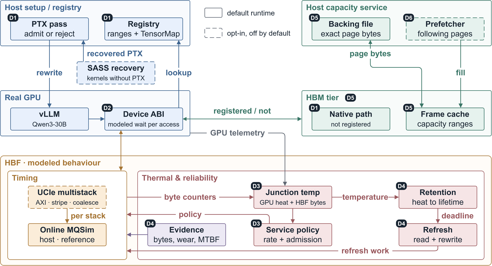
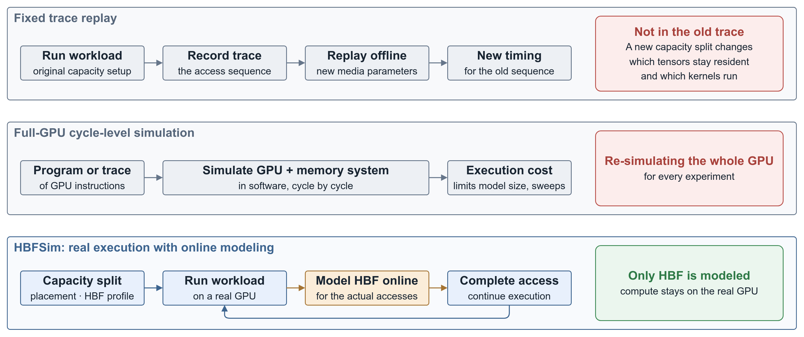

# HBFSim

**A fast HBF simulator that runs real LLM workloads on a real GPU.**

[](LICENSE)
[](https://github.com/SlugLab/HBFSim/actions/workflows/ci.yml)
[](https://arxiv.org/abs/2609.09800)

**English** | [简体中文](README.zh-CN.md)

HBFSim is a platform for comprehensively evaluating High-Bandwidth Flash (**HBF**), a memory tier that stacks NAND flash inside the accelerator package, with bandwidth comparable to HBM and capacity comparable to an SSD. The first HBF devices are expected to sample in early 2027. HBFSim executes a complete LLM (such as Qwen3-30B) normally on a real GPU at very low simulation cost, and applies HBF latency, capacity, and thermal effects to that application during execution.

📖 [HBF primer](#hbf-intro) \
📦 [Key features](#features) \
🚀 [Quick start](#quickstart) \
⚙️ [How it works](#mechanisms) \
📄 [Our paper](https://arxiv.org/abs/2609.09800) \
📝 [Open work in TODO.md](TODO.md)

<a id="question"></a>
## Why HBFSim? What are the design goals?

LLM inference serving is limited by GPU memory capacity. Designers need to decide how much capacity to give HBM and HBF each and which tensors to place in HBF, but these decisions cannot wait for HBF devices to reach the market. None of the existing methods in the table below can give the answer:

| Existing method | Why it is not enough |
|---|---|
| Fixed trace replay | Neither the architecture of HBF nor the way HBF is organized with HBM is settled; a different configuration can change the KV allocation, data migration, and kernel invocations of an LLM, changes that a trace recorded under the original configuration does not contain; re-collecting or extending a trace takes a large amount of time, and trace replay itself also has a large overhead, so fixed trace replay cannot quickly simulate different architecture choices for HBF. |
| Full-GPU cycle-level simulation | The overhead brought by full GPU microarchitecture simulation is unacceptable: single-threaded Accel-Sim takes more than 5 days of wall-clock time to simulate lavaMD (data table in the [Why traditional evaluation methods cannot be reused](#methodology) section). |
| CPU / NVMe interception | The interception point is not on the in-package GPU memory-access path; the wait time cannot be carried over directly. |
| Fixed latency and peak bandwidth | Cannot alone account for queueing, stack load, temperature, and refresh feedback during a run. |

HBFSim has the following four design goals:

- **Simulate only HBF, and leave computation to the real GPU**: the core judgment of [our paper](https://arxiv.org/abs/2609.09800) is that evaluating HBF does not require simulating the GPU, only modeling the program-visible effects of HBF. HBFSim rewrites the PTX (the intermediate code that the NVIDIA compiler generates) of application kernels and routes only the accesses within address ranges registered as HBF into the HBF model; computation still runs on the real GPU, and ordinary GPU memory accesses keep their native path.
- **Fast simulation**: HBFSim does not re-simulate the GPU in software, so HBFSim does not need to simulate warp instructions one by one the way a cycle-level simulator does. The GPU-local fast path also avoids a host round trip per request: on the same deterministic Qwen3-30B case, the simulation wall-clock time is 44.469 s on the reference path and 2.014352 s on the fast path (see [Examples and validation](#examples)).
- **Compare different HBF architectures by changing the configuration, without re-recording a trace**: every experiment reruns the workload itself on the real GPU and does not replay an old access sequence. HBF parameters are written in a profile (a JSON configuration file under `configs/profiles/`), and switching to another set of media parameters only requires switching to another profile; the same address registration can be used either in Timing-only mode to study latency alone or in Capacity mode to study capacity beyond physical GPU memory.
- **Answer concrete design questions**: HBFSim is used to evaluate the following kinds of questions on real LLM workloads:
  - **Capacity split between HBM and HBF**: for example, how much GPU memory to keep for the KV cache and how much of the weights to place in HBF; Capacity mode lets logical capacity beyond physical GPU memory run as well, so configurations that do not fit in GPU memory can also be evaluated.
  - **Tensor placement**: the targets are read-mostly data such as weights, MoE expert weights, and the KV cache of shared prefixes; for example, how much slower inference becomes when vLLM runs Qwen3-30B with the MoE expert weights placed in HBF.
  - **HBF media parameters**: including read and write latency, bandwidth, and the number of stacks; the optional UCIe multi-stack backend stripes pages across multiple stacks.
  - **Slowdown caused by temperature**: for example, the drop in sustainable service rate after the junction temperature rises, and the extra refresh traffic after the data retention deadline shortens; the optional EQ3 module models these temperature effects.

<a id="features"></a>
## Key features

- **Automatic PTX rewriting, no manual kernel changes**: HBFSim uses an interception path derived from bpftime / eGPU to automatically rewrite supported PTX global loads/stores, with no need to modify CUDA kernels by hand one by one.
- **SASS→PTX recovery for closed-source kernels (optional)**: lets closed-source precompiled kernels that lack PTX enter the same instrumentation flow as well; off by default in the ordinary entry point.
- **Registration by address, timing only for HBF addresses**: an application registers HBF address ranges through the [C API](include/hbfsim/api.h); unregistered addresses keep the native memory-access path and receive no injected HBF latency.
- **Two modes, Timing-only and Capacity**: in Timing-only mode, data stays in GPU memory, and simulated latency is injected only for registered accesses. Capacity mode backs logical data with a file and holds resident pages in a bounded page cache in GPU memory, so that logical capacity beyond physical GPU memory can run; sparse accesses to a 110 GiB logical address range have been validated on a GPU with 98 GB of memory.
- **Two timing backends**: `reference` hands requests to online MQSim, which uses a detailed media service model; `fast` computes timing locally on the GPU from the selected profile, avoiding a host round trip per request; a `hybrid` mode combines `reference` and `fast`.
- **UCIe multi-stack (optional)**: models AXI read transfers, page striping across stacks, and request coalescing, enabled with `HBFSIM_ENABLE_UCIE=ON`; currently a read-only interface, with CPU-side validation completed.
- **Thermal behavior and reliability (optional EQ3 module)**: connects junction temperature, service policy, data retention deadlines, and refresh.
- **Coverage check before launch**: before every kernel launch, the coverage gate checks whether that execution is within the modelable scope; when a Capacity address may reach code that cannot be proven safe, the coverage gate rejects the kernel launch.
- **Modeled time and wall-clock time reported separately**: the media benchmark and the CUDA microbenchmarks output modeled device time and wall-clock time separately, and do not count the simulator's own overhead as HBF latency.
- **Integration with real inference frameworks**: adapters for vLLM and llama.cpp are provided.

<a id="quickstart"></a>
## Quick start

For the recorded research setup, see the [RTX 5090 build environment and full build
commands](docs/build/rtx-5090-environment.md). For a build or runtime problem, use the
[troubleshooting guide and report forms](docs/troubleshooting.md).

HBFSim needs native Linux, CMake 3.25 or newer, Ninja, a compiler with C++20 support,
OpenSSL, and Python 3. The CUDA components need CUDA 12.8 or newer. The media simulator and
the benchmark of the media simulator build without CUDA, which is the configuration below.

```bash
git clone https://github.com/SlugLab/HBFSim.git
cd HBFSim

HBFSIM_ENABLE_CUDA=OFF HBFSIM_ENABLE_MQSIM=ON ./scripts/bootstrap.sh
cmake --build build -j"$(nproc)"
ctest --test-dir build --output-on-failure
```

### Example run

The media benchmark runs without a GPU. The media benchmark drives the online MQSim reference
model with deterministic sequential requests and emits one JSON document:

```console
$ ./build/hbf_mqsim_bench --profile configs/profiles/nominal.json \
    --requests 1024 --bytes 16384 --operation read --arrival-gap-ns 0
{
  "effective_profile": {
    "aggregate_bandwidth_bytes_per_s": 512000000000,
    "blocks_per_plane": 16,
    "capacity_bytes": 68719476736,
    "channels": 32,
    "hbm_cache_bytes": 67108864,
    "nand_technology": "SLC",
    "plane_allocation_scheme": "CWDP",
    "program_latency_ns": 100000,
    "read_latency_ns": 10000
  },
  "engine": "mqsim-hbf-media-only",
  "latency_ns": { "average": 170115, "p50": 164960, "p99": 329920 },
  "modeled_bandwidth_bytes_per_s": 50852376333.65665,
  "requests": { "completed": 1024, "submitted": 1024 },
  "simulator_requests_per_s": 6557.51045857279,
  "timing_ns": { "modeled": 329920, "wall": 156156823 }
}
```

`timing_ns.modeled` is the device time HBFSim computed; `timing_ns.wall` is how long the
computation itself took. HBFSim reports the two times separately everywhere, because a
simulator can be functionally correct while the simulator's own overhead exceeds the latency
being modeled.

For test results, the tests that CI skips, CPU build errors, and the effective capacity of the
media benchmark, see the [CPU build and test notes](docs/build/cpu-build-and-tests.md).

<a id="hbf-intro"></a>
## Introduction to HBF

HBF stacks NAND flash inside the accelerator package, below HBM and above SSDs. According to Chapter 3 of the [v0.7.0 specification](docs/HBF_OCP/ocp2026-hbf-architecture-specification-v0-7-0.pdf), HBF has 8 to 16 times the capacity of HBM with the same read bandwidth as HBM; Section 4.1 and Table 4 of the specification give **512 GiB** as an example capacity per stack and **3.072 TB/s** as the user bandwidth per stack at the highest speed grade. HBF cannot be bought yet: SanDisk plans to ship samples of its first HBF inference products in 2027 (according to [StorageReview's report on the SanDisk investor day in August 2026](https://www.storagereview.com/news/sandisk-tapes-out-its-first-hbf-memory-die-targets-2027-for-inference-product-samples)), while the timeline SK hynix showed at FMS 2026 places HBF samples in early 2028.

Because NAND is sensitive to temperature, every 10 °C rise between 20 and 70 °C shortens the data retention period to about 1/4 to 1/3 of the original period (the range is our calculation with the Arrhenius equation, using the activation energy of 1.04 eV that [HeatWatch](https://www.cs.cmu.edu/~yixinluo/index_files/heatwatch_hpca18.pdf) measured on 3D NAND). Heat keeps HBF from sustaining peak speed and causes a severe thermal throttling problem: the specification defines thermal throttling, in which the device lowers its power once the junction temperature reaches a threshold, so reads and writes slow down and, in severe cases, operations pause. The specification also guarantees 24 hours of data retention at 85 °C while the device is powered on, and refresh is typically needed every 24 to 48 hours (Chapter 9 and Section 11.5). HBF shares the package with the GPU and HBM, so heat from the GPU raises the temperature of HBF. The thermal state of the GPU also changes performance: we measured the same BF16 8192x8192 matrix multiply running alone on the same GPU at 379.117 TFLOP/s with the GPU cold and at 348.427 TFLOP/s with the GPU hot, 8.10% lower; the drop comes from the GPU compute chip lowering its own clock, not from the HBF rate ([experiment record](docs/proofs/2026-08-10-live-gpu-cd8p-thermal.md)).

Industry evaluations of HBF do not agree, and each draws its conclusions from its own testing or models: SanDisk's HBF fact sheet from July 2025 states that its numbers come from internal testing and simulation; the [H³ paper](https://doi.org/10.1109/LCA.2026.3660969) by SK hynix researchers uses an internal simulator; a HotInfra '26 workshop [paper](https://hotinfra.org/2026/papers/hotinfra26-final83.pdf) by three Micron researchers uses a roofline analytical model, which the authors say does not necessarily represent Micron's official position; Oxmiq Labs used rack-scale simulation at Hot Chips 2026 ([ServeTheHome report](https://www.servethehome.com/oxmiq-labs-hbf-in-ai-compute-at-hot-chips-2026/)). Design decisions such as how much capacity to give HBM versus HBF, or which tensors to place in HBF, cannot wait for the devices to reach the market.

<a id="architecture"></a>
## Overall architecture

<div align="center">
  
</div>

**The host side determines which accesses need to be modeled, the real GPU executes the computation, and the HBF model provides media service time and capacity behavior.** In the figure, solid boxes denote default runtime components and dashed boxes denote optional or experimental components; for the specific conditions to enable each component, see [Features and configuration](#configuration). In the figure, the registered branch to Frame cache applies to Capacity mode; in Timing-only mode, a registered access also keeps its data in place in GPU memory, and only the wait in Device helpers adds the modeled delay.

<a id="methodology"></a>
## Why traditional evaluation methods cannot be reused

**Evaluating HBF cannot mean only swapping in a new set of memory parameters for an existing GPU model, nor substituting a fixed trace for real execution after the capacity configuration changes.** The question we need to answer is how the same inference system runs under a different HBM–HBF configuration, not only how long the same sequence of requests takes in another media model.

### Fixed trace replay cannot generate execution behavior under a new configuration by itself

The current architecture of HBF, the way HBF is organized with HBM, and other such parameters are all unsettled; these parameters can change the KV allocation, data migration, and kernel invocations of an LLM. A trace simulator cannot flexibly simulate different HBF architectures. The reason is that a trace recorded under the original configuration does not automatically gain the instructions that the new configuration needs to execute, nor does the trace automatically drop migrations that are no longer needed. **Replaying the same trace with new parameters is not the same as rerunning the system with the new capacity configuration.** A trace simulator must spend a large amount of time re-collecting traces, extending traces, or adding a feedback mechanism, while trace replay itself also has a large overhead. As a result, a trace simulator cannot quickly simulate different architecture choices for HBF.

### Full-GPU cycle-level simulation turns computation into an evaluation bottleneck too

The overhead brought by full GPU microarchitecture simulation is unacceptable. Taking the two cycle-level GPU simulators [GPGPU-Sim](https://doi.org/10.1109/ISPASS.2009.4919648) and [Accel-Sim](https://doi.org/10.1109/ISCA45697.2020.00047) as examples, the table below lists the simulation speeds reported in the corresponding papers, with the data taken from the table in the motivation section of [our paper](https://arxiv.org/abs/2609.09800):

| Simulator and setting | Metric | Value |
|---|---|---:|
| Accel-Sim simulating lavaMD, single-threaded | Wall-clock time | More than 5 days |
| Accel-Sim simulating lavaMD, single-threaded | Slowdown versus real hardware | 10,748,031 times |
| Accel-Sim simulating lavaMD, 16 threads | Slowdown versus real hardware | 766,423 times |
| Accel-Sim, trace mode | Simulated warp instructions per second | 12,500 |
| Accel-Sim, execution mode | Simulated warp instructions per second | 6,000 |
| GPGPU-Sim 3.x | Simulated warp instructions per second | 3,000 |
| Accel-Sim 2.0 | Simulated warp instructions per second | 27,500 |

lavaMD is a GPU benchmark program; the three lavaMD rows come from the paper by Huerta and González, [Parallelizing a Modern GPU Simulator](https://arxiv.org/abs/2502.14691). By simulated warp instructions per second, the fastest entry in the table is Accel-Sim 2.0, which still simulates only 27,500.

The execution cost of cycle-level simulation limits production-scale models, long runs, and multidimensional parameter sweeps; extracting one Transformer block and extrapolating also cannot directly replace end-to-end execution after the capacity changes. [Accel-Sim 2.0](https://arxiv.org/abs/2608.22602)

### CPU or NVMe interception points are not on the HBF access path

Host page tables, CPU performance counters, and NVMe queues are valid interception locations in their respective systems, but **in-package HBF loads/stores issued by the GPU do not pass through these locations**. Moving the wait time of a host-side I/O directly onto a GPU memory access does not mean that HBF has been simulated. HBFSim places the hook point for supported accesses inside the GPU kernel. [PTX instrumentation design](docs/skills/02-ptx-instrumentation.md)

<div align="center">
  
</div>

The choice HBFSim makes is: **keep the real computation and the accesses as they happen, and model only the program-visible effects of HBF.** HBFSim does not replace the whole system with a simpler formula; HBFSim limits the part that must be simulated to HBF and avoids reimplementing GPU execution.

<a id="mechanisms"></a>
## Core mechanisms

### 1. Registration and instrumentation: routing GPU accesses into the HBF model

An application or adapter specifies which addresses belong to the HBF address range through explicit address registration. Unregistered addresses keep native memory-access semantics and receive no injected HBF latency; registration must finish before the first launch of the relevant kernel.

HBFSim uses an interception path derived from **bpftime / eGPU** to automatically rewrite supported PTX global loads/stores, with no need to modify CUDA kernels by hand one by one. PTX is the intermediate code generated by the NVIDIA compiler, from which the compiler backend then still generates GPU machine instructions. For precompiled kernels that lack PTX, the optional **SASS→PTX recovery path** hands selected kernels back to the same instrumentation flow.

Before every kernel launch, the **coverage gate** checks whether that execution is within the modelable scope. The coverage gate does not only record "the address is registered"; the coverage gate also distinguishes whether an access actually went through the instrumentation path.

| Access and code situation | Handling |
|---|---|
| Unregistered ordinary GPU memory address | Keeps the native memory-access path |
| Registered address, and the access can be rewritten safely | Enters the corresponding HBF modeling path |
| A Capacity address may reach code that cannot be proven safe | Rejects the kernel launch |
| A Timing address reaches code that cannot be proven safe | Allowed to execute by default, but recorded as `opaque_unmodeled_timing` and not counted toward modeled coverage; the launch is rejected under the `strict` policy |

The supported basic accesses include scalar and vector global loads/stores; uncovered accesses such as atomics, `cp.async`, and texture accesses are reported. For details, see [PTX instrumentation](docs/skills/02-ptx-instrumentation.md), [CUDA memory semantics](docs/skills/03-cuda-memory-semantics.md), and [SASS recovery](tools/sass_runtime/README.md).

### 2. GPU execution and waiting: hideable latency must not all become stalls

After a real GPU issues a load, the GPU can keep executing instructions that do not depend on the load's result, and waits only when a consumer needs the data. If the simulator synchronously waits for the full simulated latency at the issue point of the load, the wait prevents the independent instructions after the load from executing early and changes the original overlap between computation and memory access.

The **experimental dependency-point waiting path** of HBFSim separates issue from consumption: at issue, the path records a device future; at the first instruction that uses the result, the path waits for any simulated service that has not yet finished.

**The default build still uses issue-point waiting; dependency-point waiting is an experimental path that must be enabled explicitly.** Dependency-point waiting requires `HBFSIM_ENABLE_TIMING_FUTURES=ON`, CUDA 13, and `sm_120`, and currently covers loads in Timing ranges and the `fast` scalar model. On an RTX 5090, 6 wait-semantics cases have passed; for the admission conditions of the matching profiles and the limits of the existing configurations, see the [implementation and validation notes](docs/52-main-gpu-thermal-integration/README.md) and the [defect review](docs/51-defect-review-and-fixes.md).

### 3. GPU memory and capacity service: studying "slower memory" and "larger memory" separately

| Mode | Where the data actually lives | What the mode is suited to study |
|---|---|---|
| **Timing-only** | Data stays in real GPU memory, and simulated latency is injected for registered accesses | Sensitivity to latency, bandwidth, and contention |
| **Capacity** | A file backs the logical data, and a bounded page cache in GPU memory holds resident pages | Logical capacity beyond physical GPU memory, paging, and cache behavior |

The two modes share address registration, coverage rules, and profiles. In Capacity mode, file mappings in the same context share one bounded page cache: a hit accesses a resident frame; on a miss, the host capacity service reads the exact page bytes from the backing file and counts a simulated media read; evicting a dirty page involves a write-back to the backing file and a simulated media program.

> **The Capacity eviction path still has known correctness problems:** a frame may be reused before the GPU finishes consuming the frame, and rewriting dirty pages in place also violates the sequential programming constraint of HBF. Experiments that involve eviction or writes should first check the [defect description](docs/51-defect-review-and-fixes.md) and the [fix plan](TODO.md#correctness-and-fidelity). The published 110 GiB sparse-access validation did not go through the eviction path.

Runtime prefetching is separate from the current default path: the repository has an offline prefetch-sensitivity model, built through `HBFSIM_ENABLE_EVAL_TOOLS`; the runtime prefetching described in the paper is not yet in `main`. For details of capacity translation, see the [Capacity design](docs/skills/07-capacity-address-translation.md).

### 4. Timing backends: the detailed reference path and the GPU-local fast path

HBFSim uses **MQSim as a flash media model, not as a model of the SSD host software stack**, and provides three timing modes.

| Timing mode | How the mode works |
|---|---|
| `reference` | Requests go to online MQSim, which uses a detailed media service model |
| `fast` | Computes timing locally on the GPU from the selected profile, avoiding a host round trip per request |
| `hybrid` | Combines the fast path and the reference path; after a configurable warm-up, sends part of the requests to MQSim |

**Capacity mode always uses the reference path.** The parameters of `fast` are determined by the profile: synthetic profiles are for hypothetical sweeps, whereas `cd8p-vmem-p50` comes from a calibration curve of a measured software path, and synthetic profiles must not be confused with `cd8p-vmem-p50`. [Backend implementation and experiments](docs/proofs/2026-08-11-hybrid-complete.md)

The optional **UCIe multi-stack backend** further models AXI read transfers, page striping across stacks, request coalescing, and independent service limits, with one MQSim worker per stack. The UCIe backend is enabled with `HBFSIM_ENABLE_UCIE=ON`, is currently a read-only interface, and has completed CPU-side validation. [UCIe documentation](docs/ucie/README.md) · [v0.1.1 release notes](docs/releases/v0.1.1.md)

### 5. Thermal behavior and reliability: feeding temperature back into media service

The optional **EQ3 module** connects junction temperature, service policy, data retention deadlines, and refresh. Temperature is not just a column at the end of a report: temperature affects the sustainable service rate and also shortens data retention deadlines; the refresh performed to retain data in turn adds read/write traffic and maintenance overhead.

EQ3 records service and maintenance statistics and increments a wear count on each successful erase; there is currently no lifetime model for outputting MTBF. For the module design, how to enable the module, and validation records, see the [EQ3 thermal documentation](docs/eq3_thermal/README.md) and the [system thermal experiments](experiments/eq3_system_thermal/README.md).

### 6. Coverage and reporting: separating device behavior from simulator overhead

When interpreting results, distinguish **modeled device time, host service time, wall-clock time, and the overhead of HBFSim itself**. Modeled device time describes the service of the configured HBF model; wall-clock time may also include instrumentation, request round trips, and host processing, and cannot be taken directly as inference latency on future HBF hardware.

The media benchmark and the CUDA microbenchmarks already output modeled time and wall-clock time separately, and the coverage log records which launches were actually modeled. No report yet splits all four kinds of time in one place, so performance comparisons should be read together with the path used, the profile, and the raw records. [Experiment records](docs/proofs/) · [Evaluation methods](docs/eval/)

<a id="integration"></a>
## Integrating an application

Requires native Linux, CMake ≥ 3.25, Ninja, a compiler with C++20 support, OpenSSL, Python 3, and Git. The GPU components require CUDA ≥ 12.8; for the additional requirements of specific experimental paths, see [Features and configuration](#configuration). For the complete environment setup, see the [RTX 5090 build documentation](docs/build/rtx-5090-environment.md).

### Build the GPU components and connect an application

The following commands use a separate build directory; replace the CUDA path with the actual installation location on your machine.

```bash
HBFSIM_BUILD_DIR="$PWD/build-gpu" \
HBFSIM_ENABLE_CUDA=ON \
HBFSIM_CUDA_ROOT=/usr/local/cuda-12.8 \
  ./scripts/bootstrap.sh

cmake --build build-gpu -j"$(nproc)"
```

An application registers the addresses to be modeled through the [C API](include/hbfsim/api.h), for example registering a span of allocated GPU memory as a Timing range:

```cpp
const hbfsim_range_options range{
    .mode = HBFSIM_RANGE_MODE_TIMING,
    .permissions = HBFSIM_RANGE_READ_WRITE,
    .cache_policy = HBFSIM_CACHE_POLICY_NONE,
    .stream_id = 0,
};
if (hbfsim_register_device(context, data, options.bytes,
                           &range) != HBFSIM_OK) {
    fail("hbfsim_register_device failed");
}
```

The snippet is taken from the [CUDA microbenchmark](benchmarks/cuda/hbf_microbench.cu). **Registering addresses and rewriting kernels are two separate steps: calling the C API alone does not perform instrumentation automatically.** Use `scripts/run_with_bpftime.sh -- command [args ...]` to start an application that has completed registration, and set `HBFSIM_BUILD_DIR` to the build directory in use.

For existing inference frameworks, start from the corresponding adapter: [vLLM Timing](adapters/vllm/README.md), [llama.cpp](adapters/llama_cpp/); [vLLM Capacity](adapters/vllm_capacity/) is an offline capacity trace replay tool and does not load vLLM. Environment requirements and commands for the model and SASS research paths stay in their own documents, to avoid mixing them with the basic build. If you run into problems, see the [troubleshooting notes](docs/troubleshooting.md).

<a id="examples"></a>
## Examples and validation

The public validation of HBFSim covers integration with real inference frameworks, weight registration and consumer binding, logical capacity beyond GPU memory, timing calibration, the fast path, and thermal behavior. **The experiments listed below are representative; they are not all of the project's tests or all of its use cases.** For more run records, see [proofs](docs/proofs/), [OLMoE validation](docs/hbfsim-supported-weights/README.md), and the [reproduction packages](reproduction/).

| Scenario | Representative result | Record |
|---|---|---|
| **Real vLLM inference** | vLLM 0.15.1 serves Qwen3-30B-A3B; modeled latency is injected within the registered region, and the output token IDs match the baseline | [vLLM experiment](docs/proofs/2026-08-11-vllm-exact-live-delay.md) |
| **OLMoE weight integration** | The native PTX path registers 98 supported storages; with SASS recovery, all 147 deduplicated weight storages are registered, and consumer binding and fixed-request validation are completed | [Native PTX](docs/hbfsim-supported-weights/RESULTS.md) · [SASS reproduction package](reproduction/sass-final147-20260926/README.md) |
| **Logical capacity beyond GPU memory** | A 110 GiB logical address range with a 2 GiB GPU page cache; all 128 sparse accesses completed, and the checksum matches the baseline | [Capacity experiment](docs/proofs/2026-08-11-hybrid-complete.md) |
| **Timing calibration** | The six calibration points at 1, 4, 16, 64, 256, and 512 contiguous 4 KiB pages match exactly; the match is a consistency check on fitted points | [Calibration experiment](docs/proofs/2026-08-11-cd8p-vmem-tuning.md) |
| **Simulator fast path** | On the same deterministic Qwen3-30B case, the reference path takes 44.469 s and the fast path takes 2.014352 s; wall-clock time drops to about 1/22, and the outputs match | [Path comparison](docs/proofs/2026-08-11-hybrid-complete.md) |
| **Temperature sensitivity** | The same BF16 matrix multiply reaches 379.117 / 348.427 TFLOP/s in the cold and hot machine states; measured GPU compute throughput drops by 8.10% | [Thermal behavior experiment](docs/proofs/2026-08-10-live-gpu-cd8p-thermal.md) |

Use each result within the scope of its experiment: **the fast-path speedup is a ratio of the wall-clock times of two simulated runs; 110 GiB is a sparse logical-capacity validation; the temperature experiment measures the GPU's own downclocking.** None of the three results is measured performance of an HBF device.

<details>
<summary>Expand experiment configuration, coverage scope, and reproduction notes</summary>

**Experiment hardware.** Except for the OLMoE weight experiment, which ran on an RTX 5090, the other GPU results in the table above come from an NVIDIA RTX PRO 6000 Blackwell Server Edition with driver 595.84. The GDDR7 memory of the RTX PRO 6000 plays the role of the HBM tier of the modeled system in the experiments and is not real HBM. [Environment record](docs/eval/capacity_qwen3_30b_a3b.md)

**vLLM.** The listed Qwen3-30B experiment registers the first 16,384 bytes of `model.layers.0.mlp.experts.w13_weight`. Of 2,304 `fused_moe_kernel` launches, 24 were modeled launches, and 4 Triton kernel variants were bound. The vLLM experiment validates online injection within the specified region and the consistency of the output, and is not equivalent to HBF timing coverage of the whole model. [Record](docs/proofs/2026-08-11-vllm-exact-live-delay.md)

**OLMoE.** The native PTX path registers 98 storages totaling 13,091,213,312 bytes; the remaining 49 storages stay on the native path. The SASS path registers all 147 deduplicated storages totaling 13,838,323,712 bytes, and both fixed short requests return `[[70, 13]]`. Complete registration does not mean that the short requests accessed every byte or every expert, nor does complete registration represent general coverage of arbitrary models and kernels. The full 98-storage experiment has not yet been rerun in full with the rebuilt components, which have been validated on an 8-storage representative case; the final147 reproduction package has not yet completed a clean rebuild or a cross-machine GPU reproduction. [Source rebuild record](docs/hbfsim-supported-weights/REBUILT_SOURCE_VALIDATION.md) · [final147 report](reproduction/sass-final147-20260926/evidence-tree/rebuttal_20260921/sass-lifter-20260924/reports/final147-20260926-v1/REPORT.md)

**Capacity.** The 110 GiB logical range ran on a GPU that reports 97,887 MiB of memory; the checksum of the 128 accesses is `14245581564465502923`, and there were 0 unsafe launches. The capacity experiment did not physically read the entire 110 GiB and did not go through the eviction path. [Record](docs/proofs/2026-08-11-hybrid-complete.md)

**Calibration.** `cd8p-vmem-p50` comes from the complete vmem software path on a Dell CD8P NVMe SSD, including overheads such as page faults and the driver; `cd8p-vmem-p50` is neither an HBF measurement nor raw NAND latency. All six breakpoints took part in the fit; held-out validation and a fast/reference consistency comparison on the same input are still in the [validation plan](TODO.md#validation).

**Thermal behavior.** The -8.10% in the table above comes from a comparison of cold and hot exclusive matrix-multiply runs; another experiment, with a matrix multiply running concurrently with fio, gave -3.72%, and the thermal configuration uses the -3.72% figure. The -8.10% and -3.72% figures correspond to different run conditions and should not substitute for each other. [Related record](docs/proofs/2026-08-11-hybrid-complete.md)

**End-to-end performance.** The evaluation records of the current public `main` have not yet verified complete prefill/decode latency or TPOT, so the run times in the table above cannot be read directly as end-to-end inference predictions on HBF. [Evaluation scope](docs/eval/capacity_qwen3_30b_a3b.md)

</details>

<a id="configuration"></a>
## Features and configuration

The default build provides address registration, supported PTX memory-access rewriting, coverage checks, the two modes Timing / Capacity, and the MQSim reference path plus the GPU-local fast path. The options below control additional components; whether a feature has been validated on a GPU should be judged from the corresponding module documentation.

| Option | Default | Purpose |
|---|---|---|
| `HBFSIM_ENABLE_CUDA` | `ON` | CUDA instrumentation and runtime components |
| `HBFSIM_ENABLE_MQSIM` | `ON` | MQSim host service |
| `HBFSIM_ENABLE_UCIE` | `OFF` | UCIe multi-stack read-only backend; the CPU path is currently validated |
| `HBFSIM_ENABLE_LLM_TESTS` | `OFF` | llama.cpp and vLLM integration tests |
| `HBFSIM_ENABLE_EVAL_TOOLS` | `OFF` | Offline evaluation, prefetch-sensitivity model, and replay tools |
| `HBFSIM_ENABLE_TIMING_FUTURES` | `OFF` | Experimental dependency-point waiting path; requires CUDA 13 and `sm_120` |

For how the options are passed, how to enable SASS recovery and EQ3, the profiles, the 4 KiB study baseline, and the current implementation scope, see [Configuration details](docs/reference/configuration-details.md).

<a id="roadmap"></a>
## Roadmap

This section keeps only the feature milestones that affect usage and research capability; for detailed acceptance criteria, see [TODO.md](TODO.md). For release, documentation cleanup, and repository maintenance records, see the [release notes](docs/releases/v0.1.1.md).

### Done

- [x] **GPU memory-access integration and capacity tier:** explicit address registration, automatic PTX rewriting, launch coverage checks, and the two modes Timing / Capacity.
- [x] **Online media modeling:** the MQSim reference path, the GPU-local fast path, and the hybrid mode, plus the optional EQ3 thermal and maintenance module.
- [x] **Inference framework and weight integration:** vLLM and llama.cpp adapters; 98-storage validation of OLMoE on native PTX and 147-storage fixed-request validation on the optional SASS path.
- [x] **Multi-stack extension:** the UCIe read-only interface, independent MQSim workers, striping, and request coalescing, with CPU-side validation completed.
- [x] **Waiting and compatibility improvements:** the experimental implementation of dependency-point waiting with RTX 5090 semantics checks; fixes for PTX target compatibility and for several groups of timing and instrumentation defects.

### In progress

- [ ] **Improve waiting and concurrency modeling:** provide profiles that meet the admission conditions, complete the issue-point / dependency-point waiting comparison, and advance runtime prefetching.
- [ ] **Fix write and eviction semantics:** model writes in 4 KiB program units, respect the sequential programming constraint, and fix the frame lifetime race.
- [ ] **Improve media data reuse:** introduce a page buffer and cross-warp page-residency filtering, so that repeated accesses are not counted repeatedly as media reads.
- [ ] **Extend multi-stack capability:** add a write path, GPU validation, and capacity and bandwidth sweeps across different stack counts.
- [ ] **Complete validation and measurement:** held-out calibration validation, a fast/reference comparison on the same input, a split of the four kinds of time, and end-to-end prefill/decode plus formal workload evaluation.

<a id="documentation"></a>
## Documentation and code guide

| Goal | Entry point |
|---|---|
| Build, run, and troubleshoot | [Build environment](docs/build/rtx-5090-environment.md) · [Troubleshooting](docs/troubleshooting.md) |
| Understand the internal implementation | [Documentation index](docs/README.md) · [Subsystem reading guide](docs/skills/) |
| Run and reproduce experiments | [Experiment records](docs/proofs/) · [Evaluation runbooks](docs/eval/) · [Reproduction packages](reproduction/) |
| Use extension modules | [UCIe / multi-stack](docs/ucie/README.md) · [EQ3](docs/eq3_thermal/README.md) · [SASS recovery](tools/sass_runtime/README.md) |
| View plans and releases | [TODO](TODO.md) · [v0.1.1](docs/releases/v0.1.1.md) |

Historical documents, logs, and input examples use public copies with normalized paths; for how to fill in paths and verify the copies, see [PUBLIC_COPY_NOTICE.md](PUBLIC_COPY_NOTICE.md).

<details>
<summary>Repository structure</summary>

```text
HBFSim/
├── src/             # CUDA runtime, PTX pass, capacity service, timing and thermal models
├── include/hbfsim/  # public C API and host / device interfaces
├── adapters/        # vLLM and llama.cpp adapters, offline capacity trace replay
├── benchmarks/      # CUDA, MQSim, UCIe and offline evaluation benchmarks
├── configs/         # profiles, thermal configs, sweep parameters and JSON Schemas
├── scripts/         # build, run entry points, evaluation and calibration tools
├── tests/           # CPU / GPU tests and PTX fixtures
├── tools/           # SASS recovery, native PTX reproduction and thermal tools
├── experiments/     # EQ3 system thermal, rate and maintenance experiments
├── reproduction/    # fixed-experiment reproduction packages and acceptance records
├── third_party/     # pinned bpftime and MQSim
├── patches/         # patches for external dependencies
├── cmake/           # dependency builds, version pinning and PTX embedding
└── docs/            # design, experiment, specification, build and troubleshooting docs
```

`paper/` is unrelated to building and testing; bootstrap initializes only the two build dependencies bpftime and MQSim.

</details>

<a id="citation"></a>
## Paper and citation

[HBFSim: Fast and Faithful Simulation of High-Bandwidth Flash Under Real GPU Execution](https://arxiv.org/abs/2609.09800)

```bibtex
@article{hu2026hbfsim,
  title   = {HBFSim: Fast and Faithful Simulation of High-Bandwidth Flash Under Real GPU Execution},
  author  = {Hu, Yanpeng and Yang, Yiwei and Zhu, Yuanwu and Zheng, Yusheng and Quinn, Andi and Zhang, Wei},
  journal = {arXiv preprint arXiv:2609.09800},
  year    = {2026}
}
```

The repository also provides [CITATION.cff](CITATION.cff), so a citation can be obtained through GitHub's "Cite this repository".

<a id="contributing"></a>
## Contributing

See [CONTRIBUTING.md](CONTRIBUTING.md) for the contribution guide. When submitting performance or correctness results, please also provide reproducible commands, the environment, the profile, coverage records, and raw output, and state clearly whether each number is modeled time or wall-clock time.

Usage questions can be discussed in [Q&A](https://github.com/SlugLab/HBFSim/discussions/new?category=q-a); bug reports use the [issue template](https://github.com/SlugLab/HBFSim/issues/new?template=bug_report.yml), and code contributions use the [PR template](.github/pull_request_template.md). Participants are asked to follow the [code of conduct](CODE_OF_CONDUCT.md); report security vulnerabilities privately as described in [SECURITY.md](SECURITY.md).

<a id="acknowledgements"></a>
## License and acknowledgements

HBFSim is licensed under the [Apache License 2.0](LICENSE).

We thank **bpftime / eGPU** for providing the foundation for GPU interception and PTX instrumentation, and **MQSim from the ETH Zurich SAFARI Research Group** for providing the flash media model. bpftime and MQSim are kept as pinned-version dependencies, and each follows its upstream license.

We thank the contributors of [hetGPU](https://github.com/vickiegpt/Concordia) for providing the SASS→PTX recovery pipeline, which allows selected precompiled NVIDIA kernels to enter the memory-access instrumentation flow of HBFSim. hetGPU is derived from ZLUDA and is licensed under Apache-2.0 or MIT.
